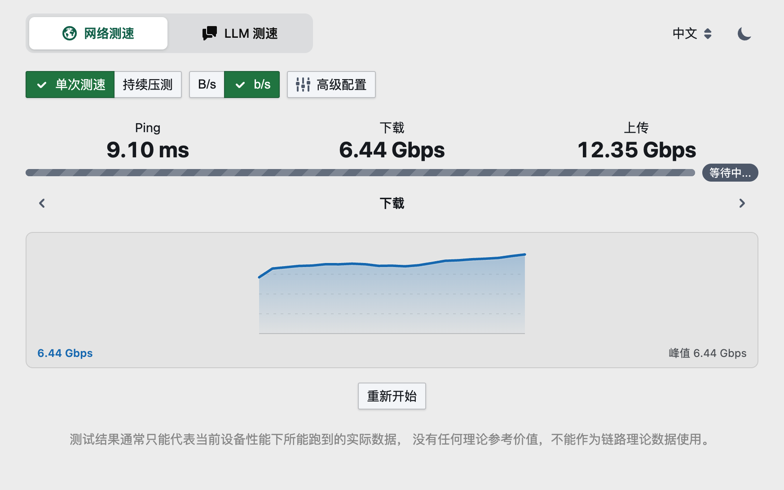
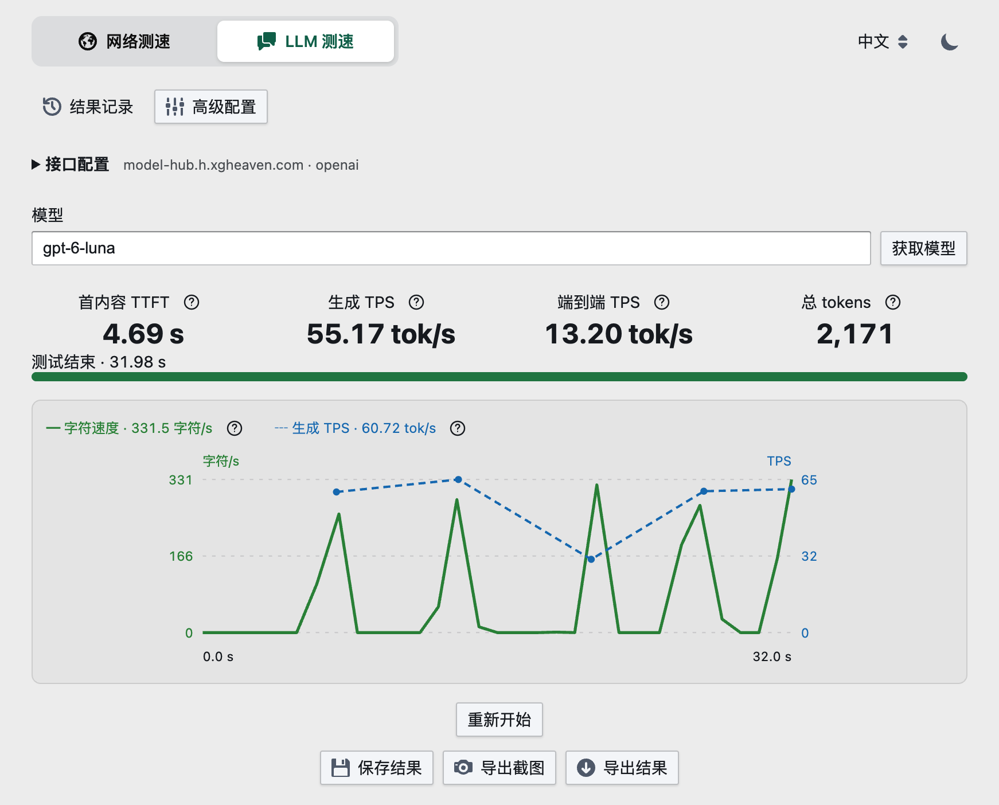

# Homebox

家庭网络与 LLM 测速工具箱，支持局域网调试、链路压测和 LLM 流式接口性能测试。

## Feature

- 面向未来浏览器设计
- 高达 10G 的浏览器速度测试
- 自带 Ping 检测
- LLM 测速，支持结果保存与导出
- 丰富的自定义测速参数
- 服务端无需像传统文件拷贝一样需要固态的支持
- 友好的 UI 交互
- 针对低速网络(< 2.5G)优化测速资源占用

<p>
  <a href="./doc/network-speedtest.png"></a>
  <a href="./doc/llm-benchmark.png"></a>
</p>

## Requirement

- 本软件需要一个服务端进行部署，然后通过客户端访问网页进行测试
- 当需要对万兆以上网络测试的时候，需要保证客户端的性能（主要为 CPU 单核）足够强劲，否则可能会成为瓶颈。
  具体的要求可以看后文的[性能测试](#performance)

## Install

### Docker

首先你需要有一台服务器，只要能支持安装 Docker 即可，比如群辉、FreeNas、unRaid、CentOS 等等。镜像架构请以所用标签为准。

```bash
docker run -d -p 3300:3300 --name homebox xgheaven/homebox
```

安装并启动 `xgheaven/homebox` 镜像，默认情况下暴露的端口是 `3300`。
然后在浏览器中输入 `http://your.server.ip:3300` 即可。

### Binary

直接在 [Release](https://github.com/XGHeaven/homebox/releases) 下载对应版本即可。

下载后执行 `serve` 启动，默认监听 `0.0.0.0:3300`：

```bash
./homebox serve --host 0.0.0.0 --port 3300
```

可选参数：

| 参数 | 用途 |
| --- | --- |
| `--host` / `--port` | 监听地址和端口 |
| `--workers` | 服务端工作线程数 |
| `--max-connections` | 最大并发连接数 |
| `--keep-alive-secs` | Keep-alive 超时（秒） |

后三项未指定时使用服务端默认设置；完整用法见 `homebox serve --help`。

## Usage

顶部可切换「网络测速」和「LLM 测速」，支持亮暗主题和中英文。

- `/#/network`：网络测速。
- `/#/llm`：LLM 测速。

刷新与浏览器前进后退会保留对应页面；直接访问首页时恢复上次选择的工具。

### 网络测速

网络测速提供单次测速和持续压测两种模式。

- **单次测速**的模式下，会依次执行 Ping/Download/Upload 测试，一般可以直接用这个模式。
- **持续压测**的模式下，可以不限时的以最高速度压测链路，通常可以用于设备移动中链路稳定性测试、多设备压测、路由器转发散热性能测试等。

默认情况下，设备会以低速模式运行，适用于大部分网络情况。
也可以在**高级配置**中切换为高速模式，此时会将客户端资源榨干的方式尽可能压榨网络流量，用于万兆以上的高速网络。

### LLM 测速

支持 OpenAI 兼容 Chat Completions、Anthropic Messages 和 Ollama Chat。填写接口地址、协议和密钥，输入模型名称或点击「获取模型」，即可开始测速。并发数、提示词、输出上限等选项位于「高级配置」。

- 默认单并发，至少运行 30 秒并完成 3 轮请求，最长 60 秒。
- 展示平均 TTFT、生成 TPS（不含首内容等待）、端到端 TPS（包含请求总耗时）和输入输出总 token 用量；详细说明见指标旁的问号。
- 双轴曲线展示字符/s 和生成 TPS，TPS 在请求完成后计算。
- 支持保存结果、导出 PNG 截图和 JSON，通过「结果记录」查看或删除已保存的结果。

接口配置（含明文密钥）和保存的结果存储在当前浏览器，结果保存与导出不包含密钥字段和生成文本。请求由 Homebox 服务端转发，接口地址中的 `localhost` 指服务端所在环境；测速会产生实际 API 用量。Homebox 无内置认证，请在可信网络使用，公网部署需自行配置访问认证。

独立模式使用 `/?alone=true#/llm`，隐藏顶部功能切换，保留语言和主题设置。

### Terminal(WIP)

某些极端情况下，机器性能不足或者浏览器版本过低，可以直接通过复制浏览器中提供的测速脚本，在终端中测速。
一方面方便某些懒人不愿意打命令行，另一方面脱离了浏览器的环境，测速性能和准确度会更高

## Development

开发启动、检查与构建步骤见 [开发指南](./DEVELOPMENT.md)。

## Design

由于众所周知的原因，浏览器中 JavaScript 的效率是比较低的，再加上网络请求的时候，需要占用大量的内存。
所以为了避免主线程的卡顿，网络测速请求在 Web Worker 中进行。

但仅仅一个 Worker 是支撑不住万兆网络的测速要求的，因为一个 Worker 并发请求的能力依旧很低。
比如使用 curl 单链接单进程最高可以达到 2GB/s 的速度，核算过来大约 16Gbps。
而一个 Worker 就算是开启多请求并发的速度，也仅仅只能达到 500MB/s，可见性能有多低。

解决方案也很简单，创建多个 Worker 叠加测速，来叠加到万兆网络的要求。
但是多个 Worker 对机器的性能要求很高，如果只是用于千兆网络测速，而机器性能又比较弱，就会导致测速不准。

这就是为什么会有两种模式的原因，**高速模式**和**低速模式**。
在高速模式下，会启用多 Worker，而低速模式下，仅仅启用一个 Worker 来减少资源的占用。

## Performance

> 目前我暂时没有万兆以上的移动端设备，如果哪位小伙伴有的话，可以将结果告诉我

以下为客户端测试

- 在 2017 款 13 寸 Macbook 上，低速配置下能够实现 4G 下载速度以及 3G 上传速度
- 在 2019 款 16 寸 Macbook 上，在开启高速模式下，最高可以达到 12G 的下载速度以及 10G 的上传速度
- 在 AMD 3600 的设备上，高速模式下可以达到 15G 的下载速度以及 12G 的上传速度
- 在 M2 Macbook Air 的设备上，低速模式可以达到 20G 的下载速度以及 16G 的上传速度，不建议开启高速模式，会导致资源调度竞争从而数值下降且不稳定

## FAQ

### 如何选择合适的下载版本

一般来说命名主要有 `<os>-<arch>` 决定。

其中 `<os>` 一般是可以选择 `windows`/`darwin`(MacOS)/`linux`，字面意思，不做过多解释。

而 `<arch>` 可以这样理解

- `arm64` 就是 arm 机器，大部分手机和部分部分笔记本选择
- `amd64` 就是 Intel 和 AMD 家的 64 位处理器（不要问为啥叫 AMD64 而不是 Intel64，问就是谁出的早谁命名，大部分台式机和笔记本和服务器选择这个就可以
- `386` 一般是 32 位机器，目前基本上不会用到

### 为什么我下载的文件无法运行

大部分情况是你下载错格式了，如果不知道如何正确选择就全都下载下来一个个尝试，总能可以的。
如果还不行，就提交 issue 把。

### 为什么 openwrt 无法运行 arm64 格式的

如果你的 openwrt 运行后突然有类似如下报错：

```shell
homebox-linux-arm64: ELF 64-bit LSB pie executable, ARM aarch64, version 1 (SYSV), dynamically linked, interpreter /lib/ld-linux-aarch64.so.1, BuildID[sha1]=9ae3c92ff31299b4b4cad04dda85694ecc9a6c65, for GNU/Linux 3.7.0, not stripped
```

则可以尝试使用 arm64-musl 格式而非 arm64 文件

## Powered by

- Rust 服务端
- TypeScript 前端语言
- React 前端框架
- Rspack 前端打包工具
- 其他依赖请查看相应文件
